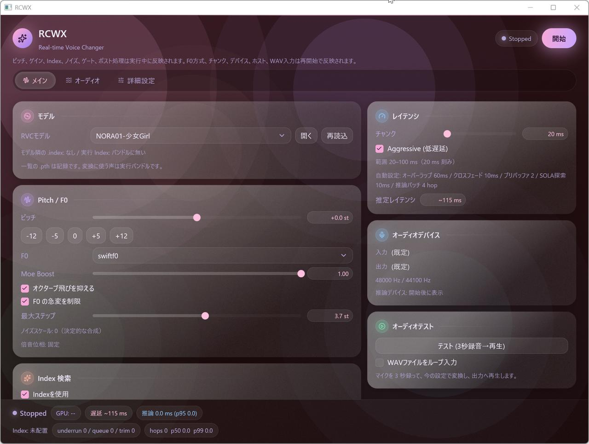
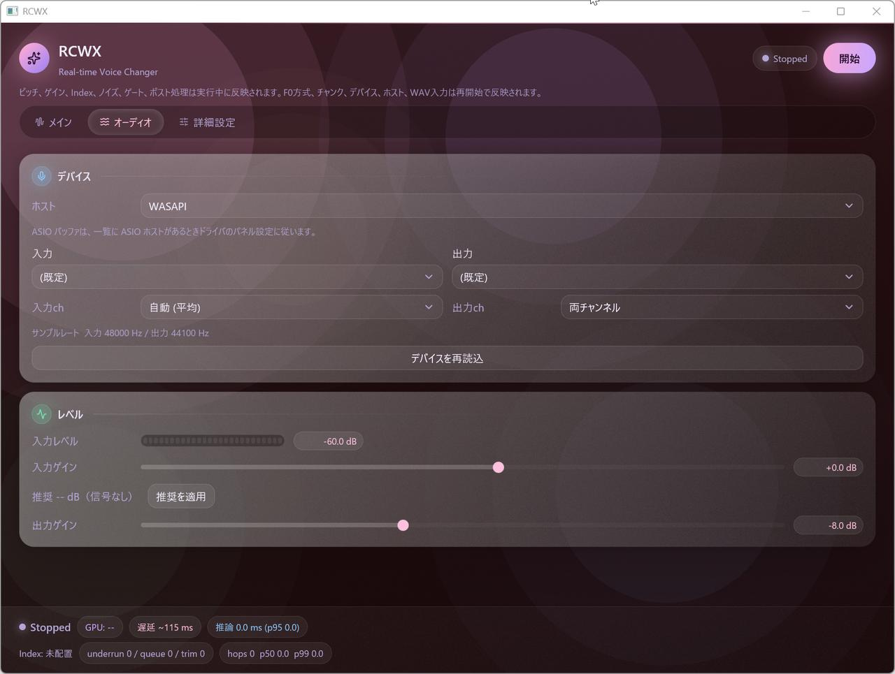
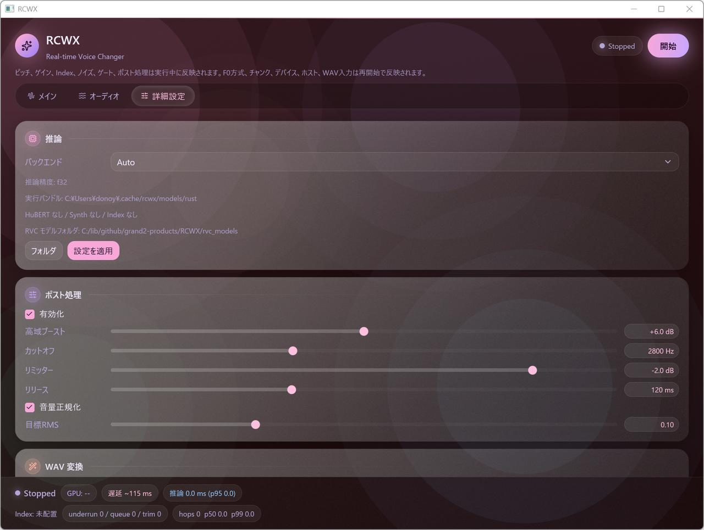

# RCWX — RVC Real-time Voice Changer on Intel Arc

RVC v2 モデルによるリアルタイムボイスチェンジャー。**製品は Rust 単一バイナリで、
実行時に Python / PyTorch への依存は一切ありません。** Python 実装
(`rcwx/`) は開発時のパリティ検証 (参照実装) としてのみ残っています。
同一環境での実測では、オフライン変換・リアルタイム推論ともに
**PyTorch XPU 実装を上回るスループット**を出しています (→
[パフォーマンス](#パフォーマンス-arc-b570-実測))。

対象環境: **Windows + Intel Arc (XPU)**。推論は独自の wgpu + WGSL
コンピュートエンジンで Intel Arc 上に直接実装しています (burn / ort /
ONNX Runtime 不使用、CUDA は未検証)。

## スクリーンショット

GUI は GPUI 製。グラスモーフィズム「トワイライト・オーロラ」テーマ
(デザインは [`crates/rcwx-gui/src/theme.rs`](crates/rcwx-gui/src/theme.rs) に一元化):



| オーディオ | 詳細設定 |
|---|---|
|  |  |

## Quick Start

```powershell
.\rcwx.ps1                    # 環境チェック (Rust) → 対話メニュー
.\rcwx.ps1 gui                # GUI 直接起動
.\rcwx.ps1 rt --seconds 10    # リアルタイム変換を 10 秒実機確認
.\rcwx.ps1 run in.wav --model rvc_models/voice.pth -o out.wav --pitch 5
```

初回のみ、共通重み (HuBERT / RMVPE / SwiftF0) をダウンロードします。
変換はバイナリ内蔵 (Python 不要) — 公式配布元から取得してその場で
safetensors に変換します:

```powershell
.\rcwx.ps1 download           # ダウンロード + 変換 → ~/.cache/rcwx/models/rust/
```

RVC モデル (`.pth`) はフォルダに置いて GUI のドロップダウンで選ぶだけです
(実行時に直接ロード・変換不要。GUI の「初回セットアップ」ボタンでも
ダウンロード+変換を実行できます)。

`rcwx.ps1` は cargo ビルド後にバイナリを起動します (cargo が無い環境では
`target/release/*.exe` を直接使用)。実行経路に Python は登場しません。

## 主な機能

- **リアルタイム変換** — 20ms hop (Aggressive) で全 hop 予算内の推論レイテンシ
  (p50 7.1ms / p99 7.4ms、hop バッチング方式、200 hop 実測)
- **GUI (GPUI)** — グラスモーフィズム「トワイライト・オーロラ」テーマの
  3 タブ構成 (メイン / オーディオ / 詳細設定)。モデル / オーディオデバイス
  (入力ch選択) / レイテンシ (自動設定+推定表示) / Pitch・F0 (F0なし対応) /
  Index 検索 / ノイズキャンセリング (spectral + 強度) / 入力ノイズゲート
  (感度) / ポスト処理 (高域ブースト・リミッター・正規化) / 入力レベルメーター /
  統計表示 / WAV 変換テスト
- **CLI** — `run` (オフライン変換) / `rt` (リアルタイム、`--virtual` は
  デバイスなし検証モード) / `info` (自前 .pth リーダ) / `devices` /
  `download` / `logs`
- **RVC v1/v2 両対応** — 256/768 次元特徴量、F0 あり/なしモデル
- **設定互換** — `~/.config/rcwx/config.json` を旧 Python 実装と共有

## パフォーマンス (Arc B570 実測)

同じマシン・同じモデル (RVC v2 / SwiftF0 / 同一 .pth) での
**Python (PyTorch XPU) 実装との直接比較**です:

| ベンチマーク | RCWX (Rust) | 旧 Python 実装 | 備考 |
|---|---|---|---|
| リアルタイム推論 (20ms hop・batch 4) | **p50 7.1ms / p99 7.4ms** | 7.5〜9.5ms (単発) | 全 hop 20ms 予算内 |
| 60 秒 WAV のオフライン変換 ( Wall time ) | **12.8〜13.1s** | 13.8〜14.3s | 交互 5 ラウンドで全勝 |
| プロセス起動 → 変換開始 | 0.8s (短尺) / 3.3s (長尺) | ~5s (torch import) | |

オフライン変換は最適化前の 125 秒 (初期の純 Rust 実装) から
**約 9.6 倍高速化**し、PyTorch XPU を下回りました。品質は E2E corr 0.984
(Python 出力との比較、gate 0.95) を維持しています。

高速化の主要内容 (詳細な実測記録は AGENTS.md):

- **fused attention** — HuBERT の多頭 attention を 1 本の WGSL カーネルに統合
  (online softmax)。T² のスコア行列を材料化しないため長尺入力のメモリと
  トラフィックが O(T) になります
- **作業バッファの全層再利用 (persistent scratch)** — 変換中間バッファを
  層ごとに確保せず 1 セット再利用。GPU driver の residency 圧迫による
  数分の 1 への減速と長尺入力時のデバイスロストを解消します
- **decode プランの再生** — 音声生成デコーダを固定形状の実行プランとして
  一度だけ構築し、チャンクごとに入力だけ差し替えて再生
  (毎チャンクのグラフ構築と 12MB の再アップロードを廃止)
- **シェーダコンパイラの使い分け** — Windows には 2 つのシェーダコンパイラ
  (FXC / DXC) があり、FXC はコンパイルが遅い代わりに生成コードが約 2 倍高速、
  DXC はその逆です (いずれも実測)。入力長に応じて自動選択します
- **カーネルの並列コンパイル** — 起動時に全 WGSL カーネルを並列コンパイル。
  従来 44 秒かかっていた起動を 3.3 秒に短縮しました

計測環境: Intel Arc B570 / wgpu 30 (DX12) / Windows 11。
`rt --virtual` (リアルタイム相当のベンチ) と `run` (オフライン) で
いつでも再現できます。


## なぜ pure Rust か (これまでの経緯)

このプロジェクトは元々 Python / PyTorch (Intel XPU) 実装として開発され、
Issue #6 で **完全 Rust シングルバイナリ化** をマイルストーン M0〜M7 として
計画・完遂しました。フレームワーク選定の経緯:

1. **burn (wgpu)** — 検証の結果、HuBERT 相当の transformer が WGSL 経由で
   約 4 倍遅く、native SPIR-V パスには数値バグがあったため不採用
2. **ort + DirectML** — 正しいが Python フリーの ONNX エクスポート
   ツールチェーンが必要で単一バイナリの目標に合わないため不採用
3. **独自 wgpu + WGSL エンジン** — 採用。matmul (tiled) / conv / softmax /
   graph 記録・plan 再生 (uniform slot システム) を自前実装し、HuBERT・
   Synthesizer (TextEncoder / Flow / GeneratorNSF / SineGen)・RMVPE・
   SwiftF0・FAISS IVF 相当の index 検索まで全て WGSL に移植

パリティは段階的に golden データで検証しています:
HuBERT cosine 1.0 / Synthesizer 0.9996 / RMVPE 0.9999 / SwiftF0 0.999 /
DSP 各モジュール (resample・SOLA・spectral gate・noise gate・postprocess)
は golden 完全一致 / **オフライン E2E corr 0.984** (Python `rcwx run` との
比較、gate 0.95)。カーネル最適化 (implicit-GEMM・活性化 fuse・FFT 相関) で
20ms hop を全 hop 予算内に収めました。fp16 (SHADER_F16) は DXC が packed
命令を生成しないため不採用 (検証記録あり)。

## GUI フレームワーク

GUI は **GPUI (gpui-kit)** 実装です。M7 で旧 Python GUI との機能 Parity を
持つ egui 版として作成後、描画層を GPUI へ置き換え済みです (エンジン層
`rcwx-nn` / `rcwx-rt` には影響なし)。見た目はグラスモーフィズム
「トワイライト・オーロラ」テーマとして `crates/rcwx-gui/src/theme.rs` に
一元化しています — DWM アクリルの Blurred 背景 + 呼吸するオーロラ、
グラデーション縁の半透明ガラスカード、ピル型タブ。`view.rs` はロジックのみを
持ち、描画は theme.rs の部品を組み立てるだけです。

## ディレクトリ構成

```text
crates/
├── rcwx-nn/     # 独自 wgpu+WGSL 推論エンジン (HuBERT/synth/RMVPE/SwiftF0/IVF)
├── rcwx-dsp/    # resample/SOLA/spectral gate/noise gate/postprocess/drift/feedback
├── rcwx-rt/     # リアルタイムエンジン (ストリーミング推論 + cpal + SPSC ring)
├── rcwx-cli/    # run / rt / info / devices / download / logs
└── rcwx-gui/    # GPUI GUI (グラスモーフィズムテーマは theme.rs)
tools/           # 重み変換 + golden 生成 (dev 専用・Python)
rcwx/            # 旧 Python 実装 (パリティ検証のリファレンス)
dev.ps1          # 開発ランチャー (check/build/test/golden/bench/e2e/fmt/clippy)
rcwx.ps1         # 製品ランチャー (純 Rust・Python 非依存)
```

## 開発

```powershell
.\dev.ps1 check               # 環境チェック
.\dev.ps1 test                # 全テスト (golden パリティ 17 件)
.\dev.ps1 bench               # 30 秒持続ベンチ (batch 1/4)
.\dev.ps1 e2e                 # Python 実装との E2E corr 比較
.\dev.ps1 golden              # パリティ検証用 golden 再生成 (実行時変換はこれに非依存)
```

詳細な開発ガイドは [AGENTS.md](AGENTS.md) を参照してください。

## モデルとライセンス

- 必須モデル: HuBERT (`hubert_base.pt`) / RMVPE (`rmvpe.pt`) / SwiftF0 (PyPI wheel) —
  `rcwx.ps1 download` が公式配布元から取得し、バイナリ内蔵の変換器で safetensors 化
- RVC モデル (`.pth`) と FAISS index は各自の権利範囲でご利用ください
  (音声モデルの権利と本人同意を必ず確認してください)
- 本体 MIT。GTCRN (MIT) は Python 参照実装側、ML Denoiser (CC BY-NC 4.0) は
  Python 参照実装側の任意依存
